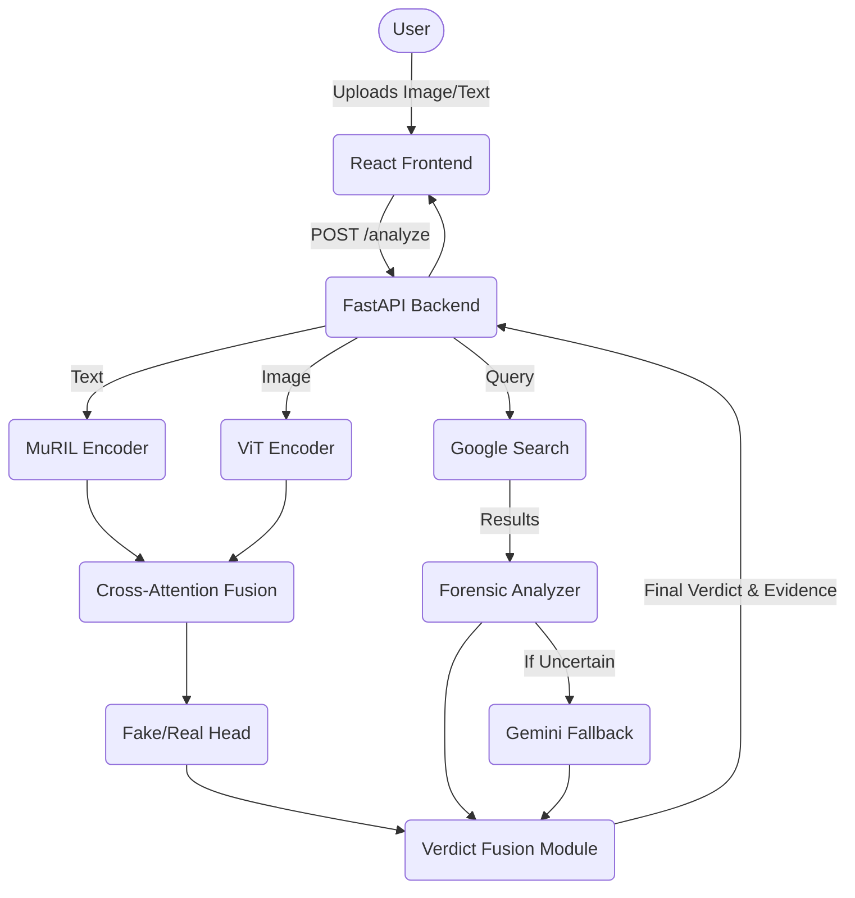

# TruthLab - Multimodal Fake News Forensics


TruthLab is an advanced, multimodal digital forensic tool designed to detect fake news and verify claims by fusing neural network predictions (text and image analysis) with live web fact-checking (Forensic Search & LLM verification).

## 🚀 The Problem & Our Solution
Fake news spreads rapidly through text, altered images, and videos. Relying solely on a single modality or a black-box AI model is insufficient because neural networks do not possess actual world knowledge—they only detect linguistic styles or image manipulations.

**The Solution:** TruthLab processes news claims through a multimodal neural network (MuRIL + Vision Transformer) and simultaneously performs a live "Forensic Fact-Check" via Google Search and Gemini. A priority-based fusion algorithm then combines these results, allowing the live fact-check to override the neural network if a factual lie is detected.

## 🎯 Key Features
- **Multimodal AI Fusion:** Custom PyTorch architecture combining MuRIL (text) and ViT (image) via Cross-Attention.
- **Visual Explainability:** Uses Grad-CAM to generate heatmaps highlighting manipulated or suspicious regions in images.
- **Forensic Override System:** Automatically queries SerpAPI and uses Gemini to fact-check claims against known credible sources (e.g., Reuters, AltNews).
- **Video Forensics:** Extracts audio, transcribes it using Sarvam AI, and interrogates the video's authenticity from "Skeptic", "Defender", and "Neutral" perspectives.
- **Zero-Shot Claim Classification:** Categorizes the news topic (e.g., Politics, Sports, Health) using XLM-RoBERTa.

## 🏗️ Architecture



## 🛠️ Tech Stack
- **Frontend:** React, Vite, Tailwind CSS, Framer Motion, Axios
- **Backend:** FastAPI, Python, Uvicorn
- **Machine Learning:** PyTorch, HuggingFace Transformers (MuRIL, ViT, XLM-RoBERTa), SHAP, OpenCV
- **External APIs:** SerpAPI (Google Search), Google Gemini-1.5-Flash, Sarvam AI (Transcription)

## 💻 Running Locally

### Prerequisites
- Python 3.10+
- Node.js 18+
- System `ffmpeg` installed (required for video audio extraction)

### Backend Setup
1. Navigate to the `backend` directory.
2. Create and activate a virtual environment:
   ```bash
   python -m venv venv
   source venv/bin/activate  # On Windows use `venv\Scripts\activate`
   ```
3. Install dependencies:
   ```bash
   pip install -r requirements.txt
   ```
4. Create a `.env` file in the `backend` directory with your API keys:
   ```env
   gemini_api_key2=your_gemini_api_key_here
   SERP_API_KEY=your_serpapi_key_here
   SARVAM_API_KEY=your_sarvam_api_key_here
   ```
5. Start the server:
   ```bash
   python -m uvicorn server:app --reload
   ```

### Frontend Setup
1. Navigate to the `frontend/vite-project` directory.
2. Install dependencies:
   ```bash
   npm install
   ```
3. Start the development server:
   ```bash
   npm run dev
   ```

## ⚠️ Known Limitations & Disclaimers
- **API Dependency:** The "Forensic Override" system relies entirely on valid SerpAPI and Gemini API keys. If these keys are invalid or hit rate limits, the system will fall back to the PyTorch neural network, which may confidently mislabel factually false (but grammatically correct) text as "REAL".
- **Performance:** Running three transformer models on a local CPU causes significant inference latency (1-3 minutes per request).
- **Security:** This is a research/prototype tool. The API endpoints are currently unprotected and file uploads are saved locally without size restrictions. Do not deploy to a public URL without adding proper authentication and input sanitization.

## 🔮 Future Improvements
- **ONNX/Quantization:** Convert PyTorch models to ONNX to drastically reduce CPU inference time.
- **Asynchronous Execution:** Refactor the inference pipeline to run the ML models and the SerpAPI web scraping concurrently via `asyncio.gather`.
- **Cloud Storage:** Migrate local file uploads (`/uploads`) to AWS S3.
- **Database:** Integrate PostgreSQL to store verification history and user sessions.
